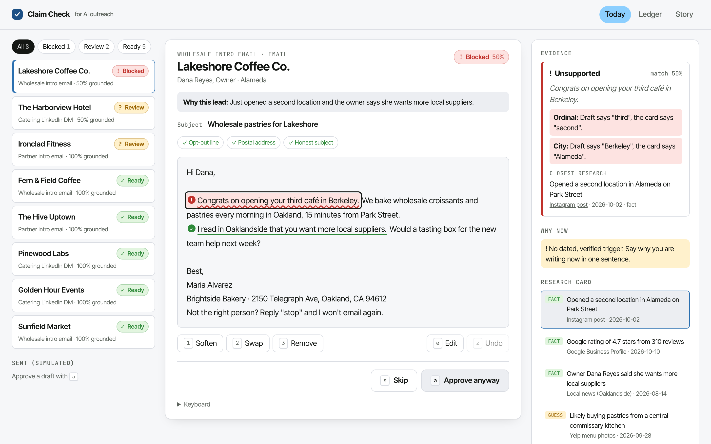
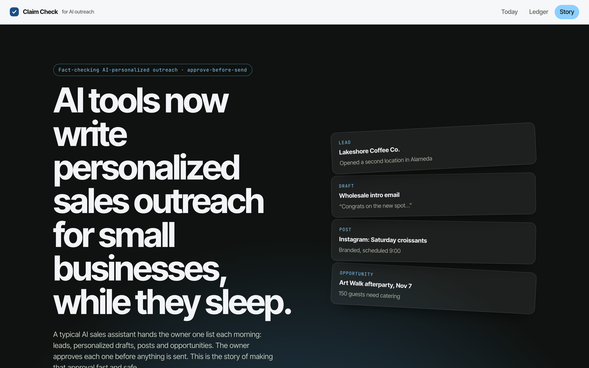
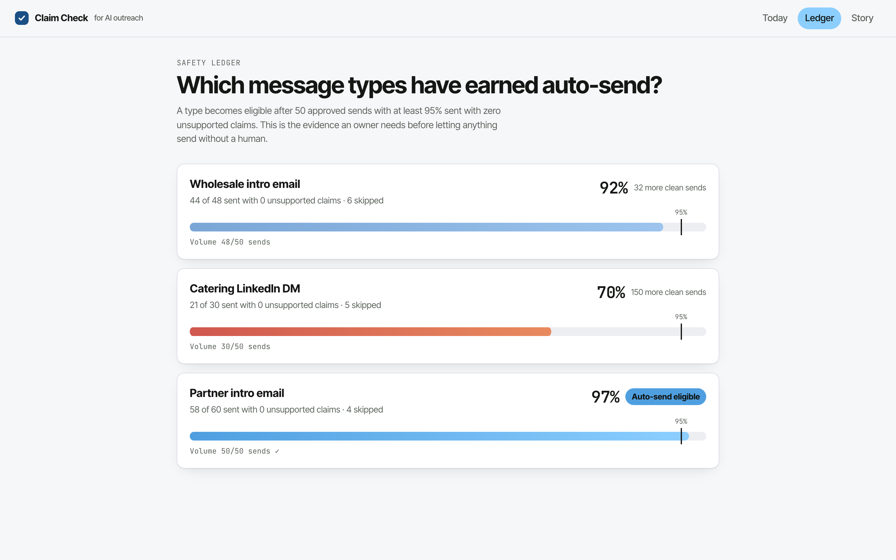
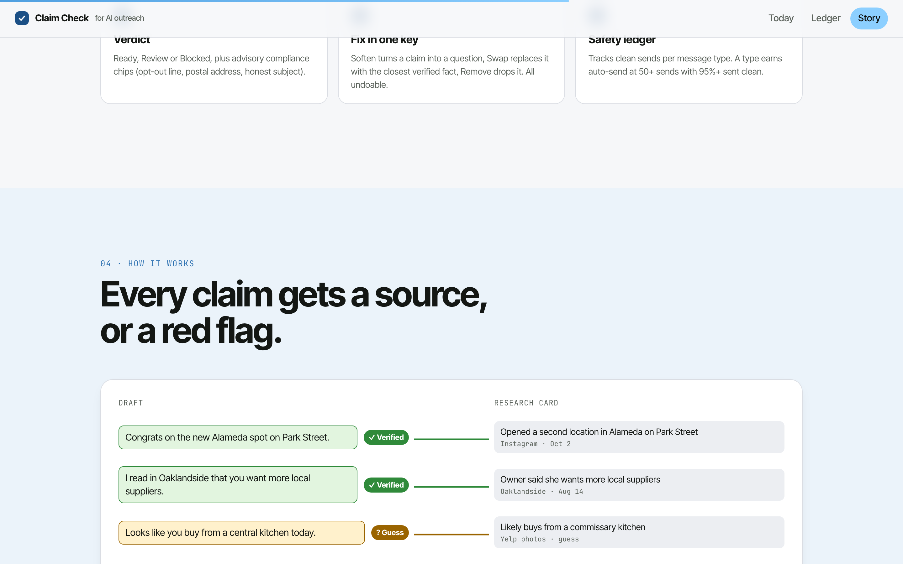

# Claim Check

**Every claim in an AI-written outreach draft gets a source, or a red flag, before the owner approves it.**

Claim Check is an independent open-source project for **fact-checking AI-personalized sales outreach**. It splits
each draft in a morning approval queue into factual claims, grounds each one against the lead's research card,
checks the "why now" sentence and gives the draft a verdict: **Ready**, **Review** or **Blocked**. One key fixes a
bad claim. A per-message-type ledger shows when a type has earned auto-send.

> All businesses, people and sources in the seed data are fictional (URLs point at `example.com`).

## The domain

AI sales assistants for small businesses now do the research and the writing: every morning the owner gets one
list of found leads, personalized outreach drafts, posts and opportunities, and approves each item before anything
is sent. Tools in this space keep that human approval step for one main reason: a wrong personal detail in an email
to a real prospect hurts trust. Good practice is to use "one true detail that matters to the offer" and to keep
facts separate from guesses, and auto-sending is treated as a later step that depends on the risk of getting it
wrong.

## The pain point

That review is the bottleneck between *drafted* and *sent*, and it is where the risk lives. Today the owner has
to check every personal detail by eye, on every draft, every morning (~90s a draft). AI SDR drafts are known to
invent personalization that looks send-ready ("congrats on your third café" when it was the second). Users of
popular AI SDR tools report invented expansions, funding rounds, titles and HQ cities in drafts that looked fine.

## What Claim Check does

| Step | What happens |
|---|---|
| **Extract** | A rule-based extractor pulls the claims about the prospect: sentences with a proper noun, number, date, ordinal, rating, city or a "congrats/saw/noticed" cue. Greetings, the sign-off, questions and "we/our" offer sentences are skipped. |
| **Ground** | Each claim is matched against the research card (facts and guesses, each with source label, URL and date) by token overlap plus **number, ordinal, city and name agreement**. **Verified** = matches a fact with no conflicts. **Guess** = matches only a guess, or a weak match. **Unsupported** = no evidence, or a hard conflict, with the exact mismatch ("Draft says third, the card says second"). |
| **Why now** | Passes when exactly one verified event claim points at a fact from the last 45 days and that sentence or the next names the offer. The one-sentence lead test. |
| **Compliance chips** | Opt-out line, postal address, no `RE:`/`FWD:`/ALL CAPS on a first email. Advisory, email only. |
| **Verdict** | Blocked if anything is unsupported (or an email fails a chip). Review if anything is a guess or why-now fails. Otherwise Ready. Plus a readiness % (verified share). |
| **Fixes** | **Soften** turns the claim into a question ("Are you hiring for a new events lead?"). **Swap** replaces it with the closest unused verified fact ("Congrats on the new Alameda spot on Park Street."). **Remove** drops it. All undoable. |
| **Ledger** | Per message type: sent, sent with 0 unsupported claims, clean rate, and **Auto-send eligible** at ≥ 50 sends and ≥ 95% clean. |

Seed queue for *Brightside Bakery* (Oakland), 2026-10-21: **5 Ready, 2 Review, 1 Blocked**. The blocked draft
to Lakeshore Coffee Co. says "your third café in Berkeley"; the card says a second location in Alameda. Press
`2` (Swap) and it flips to Ready.

## Why this feature (and not the other one)

The other candidate was a **compliance and deliverability preflight** (CAN-SPAM / PECR). It is useful but
generic: ESPs already do it, and it does nothing for how good the personalization is. Claim Check goes after the
main reason tools in this space keep a human in the loop, builds on the facts-vs-guesses research cards they
already gather, and produces the per-type safety record that would let a message type graduate to auto-send. The compliance checks still ship, as advisory chips.

**Measured on the 8-draft demo queue:** 12 claims extracted, 10 verified, 1 guess, 1 unsupported (caught), verdicts
5 Ready / 2 Review / 1 Blocked, and the blocked draft goes to Ready with one key. The seed ledger has one type
(Partner intro email, 58 of 60 sent clean, 96.7%) eligible for auto-send.

**Expected impact (targets, not measured):** review time ~90s → ~15s per draft (eyes go only to red and amber),
unsupported claims sent → 0, and a data-backed path from "approve everything" to "auto-send the safe types".

## Screenshots

| `/today` | `/story` |
|---|---|
|  |  |

| `/ledger` | `/story` (how it works) |
|---|---|
|  |  |

## Run it

```bash
pnpm i
pnpm dev          # http://localhost:3000 → /story, /today, /ledger
pnpm test         # 89 tests (Vitest + Testing Library)
pnpm test:coverage
pnpm typecheck && pnpm lint && pnpm build
```

No API keys and no network calls at runtime. `.env.example` lists optional keys that are unused by default.

Keyboard on `/today`: `j`/`k` move, `a` approve, `s` skip, `e` edit, `n` next claim, `1` soften, `2` swap,
`3` remove, `z` undo.

## Architecture

```
src/
  app/(marketing)/story/   animated explainer (motion/react), sections/*
  app/(app)/today/          morning queue UI
  app/(app)/ledger/         safety ledger UI
  app/api/queue/route.ts    GET ?date=  -> checked drafts
  app/api/check/route.ts    POST {leadId, draft} -> CheckResult (zod-validated, 400/404)
  components/               QueueList, DraftEditor, ClaimSpan, EvidencePanel, FixMenu, ComplianceChips, ...
  lib/
    types.ts                zod schemas (structured outputs everywhere)
    text.ts                 normalize, stemmer, numbers/ordinals/cities, proper nouns, overlap
    claims.ts               ClaimExtractor interface + RuleClaimExtractor
    ground.ts whyNow.ts compliance.ts verdict.ts check.ts fixes.ts ledger.ts
    repo/                   QueueRepository interface + InMemoryQueueRepository
    llm/anthropic-extractor.ts   optional Claude tool-use adapter (stub)
    analytics.ts            PostHog-shaped track() no-op
  data/                     seed JSON (business, leads, cards, drafts, history)
supabase/migrations/0001_claim_check.sql   Postgres schema + ledger view (documented, not executed)
```

- **Repository interface.** All data goes through `QueueRepository`; swapping the in-memory seed for Supabase is
  one class (see the comments and the SQL migration).
- **Model + deterministic software.** Extraction is rule-based by default and fully tested. An
  `AnthropicClaimExtractor` stub shows the tool-use schema an LLM extractor would fill; it is only selected
  with `CLAIM_EXTRACTOR=anthropic` and a key. Grounding and verdicts stay deterministic so they can be evaluated.

## Stack

Next.js 15 App Router + React 19 + TypeScript (strict) + **CSS Modules** + `motion` + zod + Vitest, deployable on
Vercel. The marketing story lives in an `app/(marketing)` route group. Data access is shaped for Postgres +
Supabase, and analytics for a PostHog-style `capture()` call, so the demo can be wired to a real backend.

## Limitations

- Rule-based extraction and grounding are tuned on a small seed; real drafts need an eval set (the
  `claim_checks` table is designed to collect one).
- Seed data only; nothing is sent. "Sent (simulated)" lives in the browser session.
- English only, Bay Area city lexicon.

## Built with Claude Code

Researched, planned, built and tested by [Claude Code](https://claude.com/claude-code), test-first.
